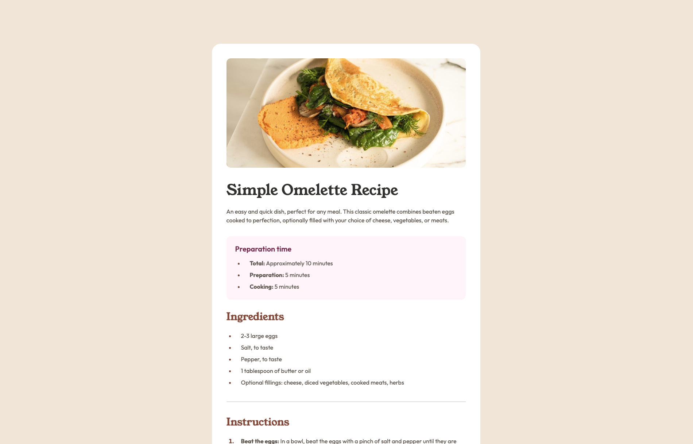

# Frontend Mentor - Recipe page solution

This is a solution to the [Recipe page challenge on Frontend Mentor](https://www.frontendmentor.io/challenges/recipe-page-KiTsR8QQKm). Frontend Mentor challenges help you improve your coding skills by building realistic projects. 

## Table of contents

- [Overview](#overview)
  - [Screenshot](#screenshot)
  - [Links](#links)
- [My process](#my-process)
  - [Built with](#built-with)
  - [What I learned](#what-i-learned)
  - [Continued development](#continued-development)

## Overview

### Screenshot

### Links

- Solution URL: https://github.com/KingRocko/Recipe-page
- Live Site URL: https://kingrocko.github.io/Recipe-page/

## My process

### Built with

- Semantic HTML5 markup
- CSS custom properties
- Flexbox

### What I learned

- Using primitive and semantic custom properties takes some time to set up, but the effort really pays off when styling components.
- Small, seemingly minor details can be quite time-consuming, as there are often several possible approaches. During this project, I had some trouble styling the list bullet points with the correct indentation. Styling the table in the final section was also a bit challenging.
- Switching the padding from the content wrapper in the mobile view to the card wrapper in the desktop view really helped a lot and made things easier.
- @font-face: Being aware that an installed static version of a font might match but lack the full range of font weights (if a variable font is needed).
- Using em instead of px for media queries to make them relative to the browser’s initial font size (for accessibility reasons).

### Continued development

- Definitely put more effort into establishing consistent naming conventions for custom properties. I still need practice and discipline to maintain consistency, as this really makes life easier in the long run.

